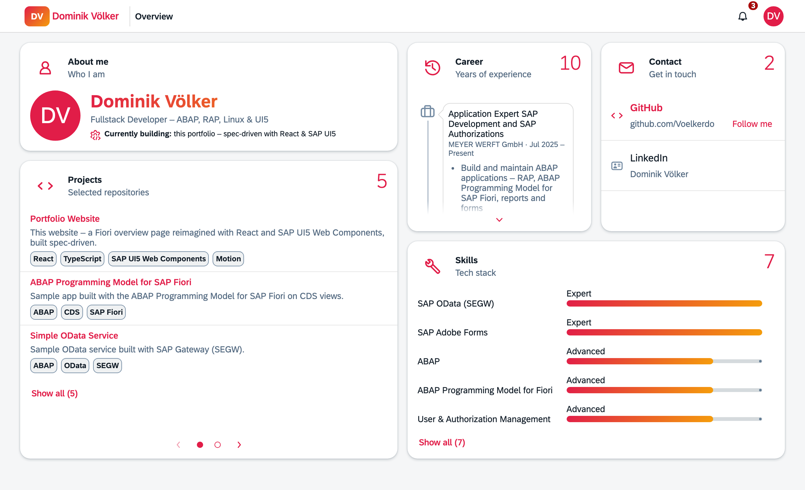
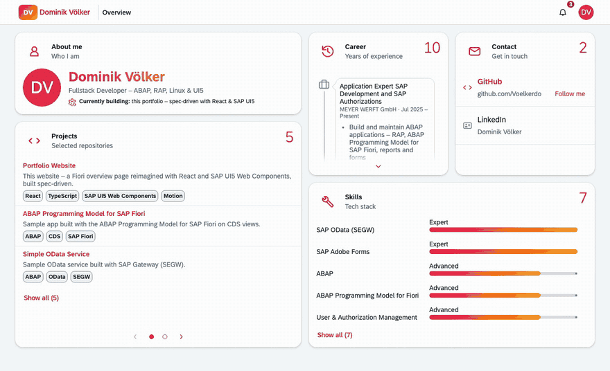

# Dominik Völker

**Fullstack Developer – ABAP, RAP, Linux & UI5**

A portfolio that looks and feels like an SAP Fiori app – 
built with React & SAP UI5 Web Components, spec-driven.

### [▶ Visit the live site](https://voelkerdo.github.io/)

[-blue.svg)](LICENSE)

<a href="https://voelkerdo.github.io/">
  <picture>
    <source media="(prefers-color-scheme: dark)" srcset=".github/readme/hero-dark.png">
    
  </picture>
</a>

## ✨ Highlights

- **A Fiori overview page, reimagined** – everything lives in animated UI5 cards on a bento grid: about me, projects, career, contact and skills with animated progress bars. Light and dark mode, keyboard accessible, and calm for everyone who prefers reduced motion.
- **Theme time travel** – open *Settings › Appearance* in the user menu and travel through 34 years of SAP UI: SAP Classic (1992), Enjoy (1999), Signature (2004), Corbu (2012), Blue Crystal (2013), Belize (2016), Quartz (2019) and Horizon (2022). Themes that UI5 no longer ships are recreated with UI5 CSS variables – and a year counter takes you there.

  

    
  

- **A transport log of this very site** – every few seconds the projects card turns to its second page: each change request that shaped this site, listed as an SAP transport (`DVK900001 · Initial release` …). It is built from the git history at build time, so it never needs maintenance.
- **A notification bell SAP folks will recognize** – *“Transport DVK900001 ‘Portfolio Website’ was imported successfully into production.”*
- **Fiori all the way down** – shell bar, user menu, a settings dialog with *Appearance* and *System* (the live versions of the stack), and a timeline you scroll station by station.

## 📐 Spec-Driven Development

This site is also an experiment in **spec-driven development**: the specs are the source of truth, the code is derived from them.

| Artifact | Question it answers |
|---|---|
| [Intent](specs/00-intent.md) | Why does this site exist, and for whom? |
| [PRD](specs/01-prd.md) | What does it do? Requirements and acceptance criteria with IDs |
| [Tech Spec](specs/02-tech-spec.md) | How is it built? Architecture and technical decisions |
| [Tasks](specs/03-tasks.md) | In which steps? Each task points to the criteria it fulfils |

Every change starts as a **change request**: impact analysis across all levels → questions → spec update → approval → implementation task by task, each with tests and its own commit (e.g. `feat(T-38): … [AC-02.7, CR-13]`). The transport log on the site is exactly this history.

The specs are written in German. The site was built in pair programming with **Claude Code** (Anthropic) as an AI assistant – the working agreement is in [`CLAUDE.md`](CLAUDE.md).

## 🛠 Tech Stack & Quality

**Stack:** React · TypeScript · Vite · [SAP UI5 Web Components](https://ui5.github.io/webcomponents/) · Motion – a static site, no backend.

- **Quality gate** – `npm run verify` runs after every change: type check, lint, unit tests (Vitest) and end-to-end tests (Playwright), including security tests against the production build. Every acceptance criterion has a test named after its ID.
- **Security & privacy** – strict Content Security Policy and referrer policy, the SAP font “72” is self-hosted, no request ever goes to a third party, no source maps. `npm audit` and registry signatures are checked on every change request and every deployment.
- **CI/CD** – GitHub Actions verifies every push to `main` and deploys it to GitHub Pages; least privilege, actions pinned to commit SHAs, no secrets. Dependabot proposes updates, and each pull request runs the full check.
- **Lighthouse** (desktop) – Performance 100 · Accessibility 95 · Best Practices 100 · SEO 100.

## License

The **source code** is licensed under the [MIT License](LICENSE).
The **personal content** – texts, career data, profile and contact data, name and likeness – is © Dominik Völker, all rights reserved, and not covered by the license (see [NOTICE](NOTICE)).
